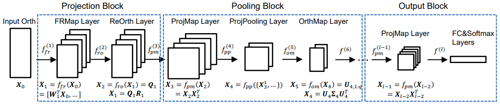

# GrNet in TensorFlow

Implementation of GrNet [1], a deep network on Grassmann manifolds.



## Requirements

 * Python 3.10+
 * SciPy
 * NumPy
 * TensorFlow 2.16+
 * tensorflow-riemopt

## Training

From the `examples` directory, train GrNet locally on the Acted Facial Expression in Wild [2] dataset:

```bash
PYTHONPATH=grnet uv run --with scipy --with requests --with tqdm \
       python -m grnet.task \
       --data-dir data \
       --job-dir ckpt
```

## References

 1. Huang, Zhiwu, Jiqing Wu, and Luc Van Gool. "Building Deep Networks on
 Grassmann Manifolds." AAAI. AAAI Press, 2018.
 2. Dhall, Abhinav, et al. "Acted facial expressions in the wild database."
 Australian National University, Canberra, Australia, Technical Report
 TR-CS-11 2 (2011): 1.
