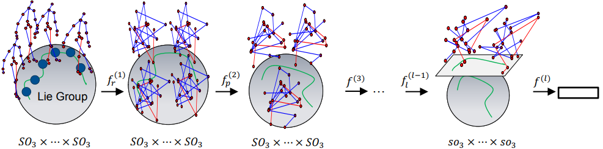

# LieNet in TensorFlow

Implementation of LieNet [1], a deep learning network on Lie Groups for
skeleton-based action recognition.



## Requirements

 * Python 3.10+
 * SciPy
 * NumPy
 * TensorFlow 2.16+
 * tensorflow-riemopt

## Training

From the `examples` directory, train LieNet locally on the G3D-Gaming [2] dataset:

```bash
PYTHONPATH=lienet uv run --with scipy --with requests --with tqdm \
       python -m lienet.task \
       --data-dir data \
       --job-dir ckpt
```

## References

 1. Huang, Zhiwu, et al. "Deep learning on Lie groups for skeleton-based
 action recognition." Proceedings of the IEEE conference on computer vision
 and pattern recognition. 2017.

 2. Bloom, Victoria, Dimitrios Makris, and Vasileios Argyriou. "G3D: A gaming
 action dataset and real time action recognition evaluation framework." 2012
 IEEE Computer Society Conference on Computer Vision and Pattern Recognition
 Workshops. IEEE, 2012.
