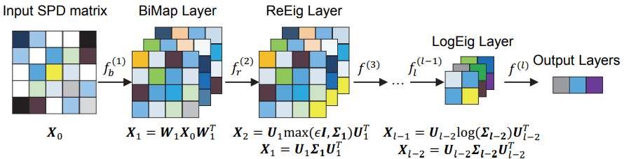

# SPDNet in TensorFlow

Implementation of SPDNet [1], a Riemannian network for SPD matrix learning.



## Requirements

 * Python 3.10+
 * SciPy
 * NumPy
 * TensorFlow 2.16+
 * tensorflow-riemopt

## Training

From the `examples` directory, train SPDNet locally on the Acted Facial Expression in Wild [2] dataset:

```bash
uv run --with scipy --with requests --with tqdm --with tensorboard \
       python -m spdnet.task \
       --data-dir data \
       --job-dir ckpt
```

## References

 1. Huang, Zhiwu, and Luc Van Gool. "A riemannian network for SPD matrix
 learning." Proceedings of the Thirty-First AAAI Conference on Artificial
 Intelligence. AAAI Press, 2017.
 2. Dhall, Abhinav, et al. "Acted facial expressions in the wild database."
 Australian National University, Canberra, Australia, Technical Report
 TR-CS-11 2 (2011): 1.
